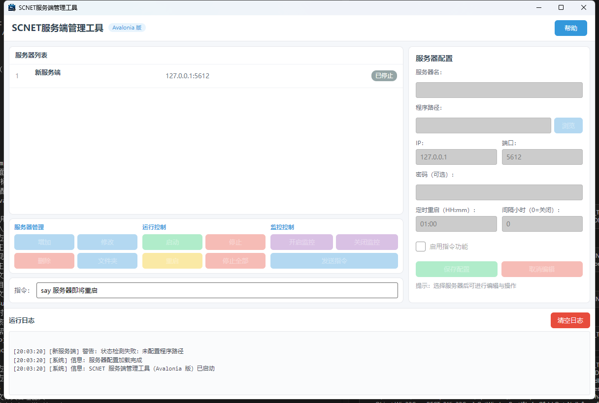
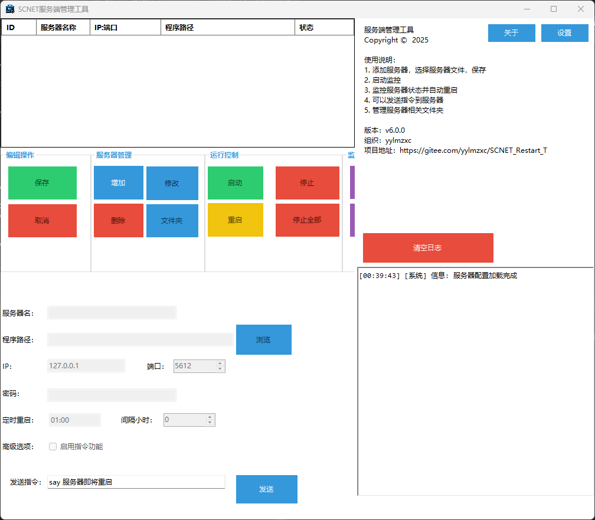

# SCNET_Restart_Tool

## Project Overview

SCNET_Restart_Tool is an advanced monitoring and automatic restart tool specifically designed for SCNET server programs (such as Survivalcraft servers). By real-time monitoring of service running status, providing multiple intelligent restart mechanisms and remote control functions, this tool ensures continuous and stable operation of server programs, minimizes manual intervention, and improves service availability and operational efficiency.

### Latest (Avalonia cross-platform) UI Preview



### Legacy (WinForms) UI Preview



## Core Features

### Multi-Server Management
- Support for configuring and managing multiple server instances simultaneously
- Each server can be independently configured with monitoring parameters and restart strategies
- Intuitive list interface displaying all servers' running status and basic information

### Intelligent Fault Detection and Auto-Restart
- Real-time monitoring of specified service process status, supporting dual verification mechanism (process name + path)
- Automatic restart when service unexpectedly terminates to ensure service continuity
- Built-in intelligent retry mechanism to handle startup failures
- Detailed operation logs for problem tracking and system analysis

### Flexible Restart Plan Strategies
- **Scheduled Restart:** Support setting daily fixed time points for automatic service restart
- **Interval Restart:** Configurable time interval (hours) for automatic service restart
- Send graceful shutdown commands before restart to ensure normal service termination
- Restart countdown prompts to keep users informed of system status changes

### Remote Command Control System
- TCP protocol interface for sending custom commands to the server remotely
- Password verification before command sending to ensure system security
- Real-time display of command execution results for remote operation monitoring

### Convenient Folder Management
- Integrated quick access to server-related folders
- Support for directly opening configuration, logs, plugins, mods, textures, worlds and other common folders
- Icon-based folder operation interface for improved management efficiency

### Comprehensive Log System
- Real-time recording of all operations and status changes
- Support for log file saving for later review and analysis
- Customizable log save path and recording level

### Program Self-Check and Permission Management
- Automatic detection of administrator privileges to ensure normal program operation
- Permission elevation options to avoid functionality limitations due to insufficient permissions

### Help & Info Menu
- The "Help" menu at the top-right of the main UI provides: Function Description, Project Info, Version Info, Check for Updates, About

### Cross-Platform Support
- The latest version is built on Avalonia UI (cross-platform XAML), a single code base targeting Windows / macOS / Linux desktops
- The previous version is built on Uno Platform with a XAML (WinUI) UI layer
- The legacy Windows version provides a WinForms GUI, and the Linux version provides a CLI

## Technical Architecture

### Development Technology Stack
- **Development Language:** C#
- **Runtime:** .NET 10.0
- **UI Framework (latest):** Avalonia UI 11.3 (Fluent theme, cross-platform XAML)
- **UI Framework (previous):** Uno Platform 6.6 (WinUI / XAML), single project mode (`UnoSingleProject`)
- **UI Framework (legacy):** Windows Forms
- **Network Communication:** Socket TCP/IP
- **Process Management:** System.Diagnostics.Process (cross-platform API); the legacy WinForms version additionally uses WMI (System.Management)
- **Configuration Management (Avalonia / Uno):** JSON serialization (`ServerConfigManager`, `servers_config.json` in the program directory)
- **Configuration Management (legacy):** XML serialization
- **Log System:** Custom `LogManager` component (daily files `log_yyyyMMdd.txt` in the program directory)

## Project Structure

```
SCNET_Restart_Tool/
├── README.md                      # Project documentation
├── src/
│   ├── SCNET_Restart_Tool.NET/    # Legacy WinForms project (Windows / Linux CLI)
│   │   ├── 界面/                  # WinForms UI code (main form, settings, folder manager, etc.)
│   │   ├── Res/                   # Resources (icons, preview image index.png, etc.)
│   │   └── ...                    # Models, services, configuration logic
│   ├── SCNET_Restart_Tool.Avalonia/  # Latest Avalonia UI project (recommended)
│   │   ├── preview.png             # UI preview image
│   │   ├── SCNET_Restart_Tool.Avalonia.sln
│   │   └── SCNET_Restart_Tool.Avalonia/  # Main app project
│   │       ├── Program.cs                   # Entry point (BuildAvaloniaApp)
│   │       ├── App.axaml / App.axaml.cs     # Theme, global styles and app class
│   │       ├── MainWindow.axaml / .axaml.cs # Main window (view-switch navigation)
│   │       ├── Views/                       # MainView, FolderManagerView
│   │       ├── Controls/                    # FolderBrowserControl, BugsLogControl
│   │       ├── Services/                    # DialogService/DialogWindow, process & command services
│   │       ├── Code/                        # Core logic (same as Uno version)
│   │       ├── Help/HelpContent.cs          # Help content constants
│   │       └── Assets/app.ico               # App icon
│   └── SCNET_Restart_Tool.Uno/    # Previous Uno Platform project
│       ├── Directory.Build.props / Directory.Packages.props / global.json
│       ├── SCNET_Restart_Tool.Uno.sln
│       └── SCNET_Restart_Tool.Uno/          # Main app project
│           ├── App.xaml / App.xaml.cs       # App entry point and resources
│           ├── MainPage.xaml / MainPage.xaml.cs  # Main UI
│           ├── FolderManagerPage.xaml/.cs   # Folder manager page
│           ├── Code/                        # Core logic (models and services)
│           │   ├── ServerStatus.cs          # Server status enumeration
│           │   ├── ServerConfig.cs          # Server configuration model
│           │   ├── ServerConfigManager.cs   # JSON config read/write
│           │   ├── ServerMonitor.cs         # Process monitoring / start-stop / TCP commands
│           │   ├── LogManager.cs            # Log manager (singleton)
│           │   ├── LogItem.cs               # Log item data structure
│           │   └── FolderOperations.cs      # Folder operations (confirm/notify/pick delegates)
│           ├── Controls/                    # Custom controls
│           │   ├── FolderBrowserControl.xaml/.cs  # Folder browser control
│           │   └── BugsLogControl.xaml/.cs       # Bugs log control
│           ├── DispatcherQueueExtensions.cs # DispatcherQueue async extensions
│           └── Properties/                  # Publish profiles etc.
└── ...
```

## Build Instructions

### Build the Avalonia Version (Recommended)

```powershell
dotnet build src\SCNET_Restart_Tool.Avalonia\SCNET_Restart_Tool.Avalonia.sln -c Release
# Run
dotnet run --project src\SCNET_Restart_Tool.Avalonia\SCNET_Restart_Tool.Avalonia
```

Alternatively, open `src\SCNET_Restart_Tool.Avalonia\SCNET_Restart_Tool.Avalonia.sln` in Visual Studio / Rider to build and run.

### Build the Previous Uno Version

> **Note:** The Uno project uses `Uno.Sdk` (which includes custom MSBuild tasks such as `XamlCompiler`).
> On Windows, please build with **Visual Studio's MSBuild** (`dotnet build` may cause `XamlCompiler.exe`
> to exit silently, making XAML compilation errors impossible to diagnose).

```powershell
# Use VS MSBuild (adjust the path to your actual VS version, here VS 2026 Community)
& "C:\Program Files\Microsoft Visual Studio\18\Community\MSBuild\Current\Bin\MSBuild.exe" `
  "src\SCNET_Restart_Tool.Uno\SCNET_Restart_Tool.Uno.sln" -t:Rebuild -p:Configuration=Debug
```

Alternatively, open `src\SCNET_Restart_Tool.Uno\SCNET_Restart_Tool.Uno.sln` in Visual Studio to build and run.

### Build the Legacy WinForms Version (Windows)

```powershell
dotnet build src\SCNET_Restart_Tool.NET\SCNET_Restart_Tool.NET.csproj
```

## Installation and Usage

### System Requirements
- **Windows (Avalonia / legacy):** Windows 10/11, .NET 10.0 Runtime or higher; run as administrator for process monitoring
- **macOS / Linux (Avalonia):** Systems supporting .NET 10.0 (macOS 12+; Ubuntu 22.04+, CentOS 9+, etc.)
- **Linux (legacy CLI):** Linux distributions supporting .NET 10.0
- **Hardware Requirements:** Minimal system resources (CPU: 1GHz+, RAM: 512MB+)

### Basic Operation Flow
1. **Add Server:** Click "增加 (Add)", fill in server name, program path, IP/port, then click "保存配置 (Save)"
2. **Configure Restart Strategy:** Set scheduled restart (HH:MM) or interval restart (hours, 0 to disable)
3. **Start Monitoring:** Select the configured server and click "开启监控 (Start Monitoring)"; crashed servers restart automatically
4. **Process Control:** Use "启动 / 停止 / 重启 / 停止全部 (Start / Stop / Restart / Stop All)" buttons
5. **Remote Control:** Enable the command feature, then use the command box + "发送指令 (Send Command)" (e.g. `close 9 Maintenance`)
6. **Manage Folders:** Click "文件夹 (Folders)" to access Bugs, Configs, Plugins, Worlds directories with backup / clean / delete support
7. **View Logs:** Real-time logs at the bottom of the main UI, also written daily to `log_yyyyMMdd.txt` in the program directory

### Configuration File Location
- **Avalonia / Uno version:** JSON configuration file (`servers_config.json`), read/written by `ServerConfigManager`
- **Legacy version (WinForms):** `ServerConfigs.xml` in the program directory

## Notes

1. **Administrator Privileges:** On Windows the program requires administrator privileges to correctly monitor and manage system processes; please run as administrator
2. **Cross-Platform Differences:** Graceful close (`CloseMainWindow`) only works on Windows; on macOS / Linux the process is killed directly. Process path verification depends on system permissions
3. **Configuration File Backup:** Regularly back up the configuration file (`servers_config.json`) to prevent configuration loss
4. **Network Security:** When using remote command functionality, set a strong password and restrict access IPs
5. **Log Management:** Regularly clean log files (`log_yyyyMMdd.txt`) to avoid occupying too much disk space

## Migration Notes (WinForms → Uno)

- The pure logic layer (models and services under `Code/`) is ported almost unchanged
- The UI layer is rewritten in XAML (WinUI) to replace the original WinForms forms
- `MessageBox` / file dialogs are replaced by `ContentDialog` / `FileOpenPicker` (with `WinRT.Interop.InitializeWithWindow`)
- WinForms `Timer` / `Invoke` are replaced by `System.Threading.Timer` / `DispatcherQueue`
- UI-dependent operations are injected through static delegates in `FolderOperations` (`ConfirmAsync` / `NotifyAsync` / `PickFileAsync`)

## Migration Notes (Uno → Avalonia)

- Based on the Uno version; the models and services under `Code/` (`ServerMonitor` / `ServerProcessService` / `ServerCommandService` / `LogManager` / `FolderOperations`, etc.) are reused unchanged
- The UI layer now uses Avalonia 11 XAML (Fluent theme): `Page` → `UserControl` views, `Frame` navigation → `ContentControl` view switching inside the main window
- `ContentDialog` → custom `DialogWindow` (modal `ShowDialog`); `FileOpenPicker` → `StorageProvider.OpenFilePickerAsync` (cross-platform file picking)
- `ListView` / `TabView` / `PasswordBox` are replaced by `ListBox` / `TabControl` / `TextBox(PasswordChar)`; `x:Bind` → `{Binding}`
- `DispatcherQueue` → `Avalonia.Threading.Dispatcher` / `DispatcherTimer`; colored buttons keep their brand colors via a custom `ControlTheme`
- Status badge colors come from `ServerConfig.StatusBrush` (Avalonia `IBrush`), still refreshed manually via `RaisePropertyChanged`

## Update Log

### v2.1.0 (Avalonia, 2026-11)
- Added a cross-platform desktop version based on Avalonia UI 11.3 (`src/SCNET_Restart_Tool.Avalonia`), a single code base for Windows / macOS / Linux
- UI layer migrated from Uno (WinUI XAML) to Avalonia XAML; the core logic layer is reused unchanged
- Dialogs and file picking now use Avalonia `DialogWindow` / `StorageProvider`, removing the WinRT dependency
- The Uno version and legacy versions are kept and remain buildable

### v2.0.0 (Migration)
- Migrated to Uno Platform 6.6 (WinUI / XAML), UI layer fully rewritten
- Configuration management switched from XML to JSON
- Core logic layer (models / services) reused

### v1.1.0
- Upgraded project framework to .NET 10.0; both Windows and Linux versions now use .NET 10.0 Runtime
- System.Management dependency upgraded to 10.0.0

### v1.0.0
- Initial version release
- Basic server monitoring and automatic restart functions
- Multi-server management support
- Windows graphical interface version

## License

This project is licensed under the MIT License - see the LICENSE file for details.

## Disclaimer

This tool is provided "as is" without any warranty. Use it in compliance with applicable laws and regulations. The author shall not be liable for any direct or indirect damages arising from the use of this tool.

---

For any issues or suggestions, please submit an Issue to the project's repository page.
