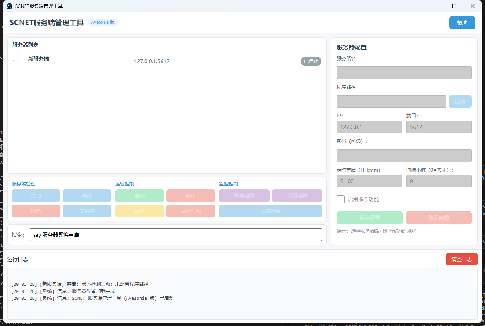

# SCNET_Restart_Tool

## 项目简介

SCNET_Restart_Tool 是一款专为 SCNET 服务端程序（如生存战争服务器）设计的高级监控与自动重启工具。该工具通过实时监控服务运行状态，提供多种智能重启机制和远程控制功能，确保服务端程序持续稳定运行，最大限度减少人工干预，提高服务可用性和运维效率。

### 最新版（Avalonia 跨平台版）界面预览




## 核心功能特性

### 多服务器管理
- 支持同时配置和管理多个服务端实例
- 每个服务器可独立设置监控参数和重启策略
- 直观的列表界面展示所有服务器运行状态和基本信息

### 智能故障检测与自动重启
- 实时监控指定服务进程状态，支持进程名+路径双重验证机制
- 服务意外终止时自动执行重启操作，确保服务连续性
- 内置智能重试机制，应对启动失败的情况
- 详细的操作日志记录，便于问题追溯和系统分析

### 灵活的重启计划策略
- **定时计划重启**：支持设置每日固定时间点自动重启服务
- **间隔周期重启**：可按设定的时间间隔（小时）自动重启服务
- 重启前可发送优雅关闭指令，确保服务正常终止
- 重启倒计时提示，便于用户了解系统状态变更

### 远程命令控制系统
- 提供 TCP 协议接口，可远程向服务端发送自定义命令
- 支持命令发送前的密码验证，保障系统安全性
- 实时显示命令执行结果，便于远程操作监控

### 便捷的文件夹管理
- 集成服务器相关文件夹快速访问功能
- 支持直接打开配置、日志、插件、模组、纹理、世界等常用文件夹
- 提供图标化的文件夹操作界面，提高管理效率

### 完善的日志系统
- 实时记录所有操作和状态变更
- 支持日志文件保存，便于后期查阅和分析
- 可自定义日志保存路径和记录级别

### 程序自检与权限管理
- 自动检测管理员权限，确保程序正常运行
- 提供权限提升选项，避免因权限不足导致功能受限

### 帮助与信息菜单
- 主界面右上角「帮助」菜单提供：功能说明、项目信息、版本信息、检查更新、关于

### 跨平台支持
- **最新版**基于 Avalonia UI（跨平台 XAML），一套代码支持 Windows / macOS / Linux 桌面端
- 上一版基于 Uno Platform，UI 层使用 XAML（WinUI），已保留可构建
- 旧版 Windows 版提供 WinForms 图形界面，Linux 版提供命令行界面

## 技术架构

### 开发技术栈
- **开发语言**：C#
- **运行时**：.NET 10.0
- **UI 框架（最新版）**：Avalonia UI 11.3（Fluent 主题，跨平台 XAML）
- **UI 框架（上一版）**：Uno Platform 6.6（WinUI / XAML），单项目模式（`UnoSingleProject`）
- **UI 框架（旧版）**：Windows Forms
- **网络通信**：Socket TCP/IP
- **进程管理**：System.Diagnostics.Process（跨平台 API）；旧版（WinForms）另使用 WMI（System.Management）
- **配置管理（Avalonia / Uno 版）**：JSON 序列化（`ServerConfigManager`，`servers_config.json`，位于程序目录）
- **配置管理（旧版）**：XML 序列化
- **日志系统**：自定义 `LogManager` 组件（按日期写入程序目录 `log_yyyyMMdd.txt`）

## 项目结构

```
SCNET_Restart_Tool/
├── README.md                      # 项目说明文档
├── src/
│   ├── SCNET_Restart_Tool.NET/    # 旧版 WinForms 项目（Windows / Linux CLI）
│   │   ├── 界面/                  # WinForms 界面代码（主窗体、设置、文件夹管理等）
│   │   ├── Res/                   # 资源文件（图标、预览图 index.png 等）
│   │   └── ...                    # 模型、服务、配置等核心逻辑
│   ├── SCNET_Restart_Tool.Avalonia/  # 最新版 Avalonia UI 项目（推荐）
│   │   ├── preview.png             # 界面预览图
│   │   ├── SCNET_Restart_Tool.Avalonia.sln
│   │   └── SCNET_Restart_Tool.Avalonia/    # 应用主工程
│   │       ├── Program.cs                   # 入口（BuildAvaloniaApp）
│   │       ├── App.axaml / App.axaml.cs     # 应用主题、全局样式与入口类
│   │       ├── MainWindow.axaml / .axaml.cs # 主窗口（承载视图切换导航）
│   │       ├── Views/                       # 视图（对应原 Uno 版 Page）
│   │       │   ├── MainView                 # 主界面（列表/控制/编辑/日志）
│   │       │   └── FolderManagerView        # 文件夹管理器
│   │       ├── Controls/                    # 自定义控件
│   │       │   ├── FolderBrowserControl     # 文件夹浏览控件
│   │       │   └── BugsLogControl           # Bugs 日志控件（Game.log 分页预览）
│   │       ├── Services/                    # 服务层
│   │       │   ├── DialogService.cs         # 对话框服务（提示/确认/文件选择）
│   │       │   ├── DialogWindow.cs          # 自定义对话框窗口（替代 ContentDialog）
│   │       │   ├── ServerProcessService.cs  # 进程启停与状态检测
│   │       │   └── ServerCommandService.cs  # TCP 指令通讯
│   │       ├── Code/                        # 核心逻辑（与 Uno 版一致）
│   │       │   ├── ServerStatus.cs          # 服务器状态枚举
│   │       │   ├── ServerConfig.cs          # 服务器配置模型（含状态徽标配色）
│   │       │   ├── ServerConfigManager.cs   # JSON 配置读写
│   │       │   ├── ServerMonitor.cs         # 监控调度（定时/间隔/自动重启）
│   │       │   ├── LogManager.cs            # 日志管理器（单例）
│   │       │   ├── LogItem.cs               # 日志项数据结构
│   │       │   └── FolderOperations.cs      # 文件夹操作（备份/清理/删除）
│   │       ├── Help/HelpContent.cs          # 帮助内容常量
│   │       └── Assets/app.ico               # 应用图标
│   └── SCNET_Restart_Tool.Uno/    # 上一版 Uno Platform 项目
│       ├── Directory.Build.props / Directory.Packages.props / global.json
│       ├── SCNET_Restart_Tool.Uno.sln
│       └── SCNET_Restart_Tool.Uno/          # 应用主工程
│           ├── App.xaml / App.xaml.cs       # 应用入口与资源
│           ├── MainPage.xaml / MainPage.xaml.cs  # 主界面
│           ├── FolderManagerPage.xaml/.cs   # 文件夹管理器页
│           ├── Code/                        # 核心逻辑（模型与服务）
│           │   ├── ServerStatus.cs          # 服务器状态枚举
│           │   ├── ServerConfig.cs          # 服务器配置模型
│           │   ├── ServerConfigManager.cs   # JSON 配置读写
│           │   ├── ServerMonitor.cs         # 进程监控 / 启停 / TCP 指令
│           │   ├── LogManager.cs            # 日志管理器（单例）
│           │   ├── LogItem.cs               # 日志项数据结构
│           │   └── FolderOperations.cs      # 文件夹操作（确认/通知/选文件委托）
│           ├── Controls/                    # 自定义控件
│           │   ├── FolderBrowserControl.xaml/.cs  # 文件夹浏览控件
│           │   └── BugsLogControl.xaml/.cs       # Bugs 日志控件
│           ├── DispatcherQueueExtensions.cs # DispatcherQueue 异步扩展
│           └── Properties/                  # 发布配置等
└── ...
```

## 构建说明

### 构建 Avalonia 最新版（推荐）

```powershell
dotnet build src\SCNET_Restart_Tool.Avalonia\SCNET_Restart_Tool.Avalonia.sln -c Release
# 运行
dotnet run --project src\SCNET_Restart_Tool.Avalonia\SCNET_Restart_Tool.Avalonia
```

或在 Visual Studio / Rider 中直接打开 `src\SCNET_Restart_Tool.Avalonia\SCNET_Restart_Tool.Avalonia.sln` 进行构建与运行。

> **注意**：构建 Uno 项目请继续参考下方说明（`Uno.Sdk` 的 `XamlCompiler` 建议使用 VS MSBuild）。

### 构建 Uno 上一版

> **注意**：Uno 项目使用 `Uno.Sdk`（含 `XamlCompiler` 等 MSBuild 自定义任务）。
> 在 Windows 上请使用 **Visual Studio 的 MSBuild** 构建（`dotnet build` 环境下 `XamlCompiler.exe` 可能静默退出导致 XAML 编译异常）。

```powershell
# 使用 VS MSBuild（路径以实际 VS 版本为准，此处为 VS 2026 Community）
& "C:\Program Files\Microsoft Visual Studio\18\Community\MSBuild\Current\Bin\MSBuild.exe" `
  "src\SCNET_Restart_Tool.Uno\SCNET_Restart_Tool.Uno.sln" -t:Rebuild -p:Configuration=Debug
```

或在 Visual Studio 中直接打开 `src\SCNET_Restart_Tool.Uno\SCNET_Restart_Tool.Uno.sln` 进行构建与运行。

### 构建旧版 WinForms（Windows 版）

```powershell
dotnet build src\SCNET_Restart_Tool.NET\SCNET_Restart_Tool.NET.csproj
```

## 安装与使用

### 系统要求
- **Windows（Avalonia / 旧版）**：Windows 10/11，安装 .NET 10.0 Runtime 或更高版本；监控进程建议以管理员身份运行
- **macOS / Linux（Avalonia 版）**：支持 .NET 10.0 的系统（macOS 12+；Ubuntu 22.04+、CentOS 9+ 等）
- **Linux（旧版 CLI）**：支持 .NET 10.0 的 Linux 发行版
- **硬件要求**：最小系统资源（CPU: 1GHz+，内存: 512MB+）

### 基本操作流程
1. **添加服务器**：点击「增加」，填写服务器名称、程序路径、IP/端口等，然后点击「保存配置」
2. **配置重启策略**：设置定时重启（HH:MM）或间隔重启（小时数，0 表示禁用）
3. **启动监控**：选择已配置的服务器，点击「开启监控」；服务意外退出时会自动重启
4. **运行控制**：通过「启动 / 停止 / 重启 / 停止全部」按钮管理服务端进程
5. **远程控制**：启用指令功能后，使用指令输入框 +「发送指令」（如 `close 9 例行维护`）
6. **管理文件夹**：点击「文件夹」，快速访问 Bugs、Configs、Plugins、Worlds 等目录，支持备份 / 清理 / 删除
7. **查看日志**：主界面底部实时显示运行日志，并按日期写入程序目录的 `log_yyyyMMdd.txt`

### 配置保存位置
- **Avalonia / Uno 版**：程序目录下 JSON 配置文件（`servers_config.json`），由 `ServerConfigManager` 负责读写
- **旧版（WinForms）**：程序目录下 `ServerConfigs.xml`

## 注意事项

1. **管理员权限**：Windows 下程序需要管理员权限才能正确监控和管理系统进程，请确保以管理员身份运行
2. **跨平台行为差异**：优雅关闭（`CloseMainWindow`）仅在 Windows 上有效，macOS / Linux 上将直接强制结束进程；进程路径校验依赖系统权限
3. **配置文件备份**：建议定期备份程序配置文件（`servers_config.json`），以防止配置丢失
4. **网络安全**：使用远程命令功能时，请确保设置强密码并限制访问 IP
5. **日志管理**：定期清理日志文件（`log_yyyyMMdd.txt`），避免占用过多磁盘空间

## 迁移说明（WinForms → Uno）

- 纯逻辑层（`Code/` 下的模型与服务）近乎原样迁移，不依赖 UI 框架
- UI 层使用 XAML（WinUI）重写，替代原有 WinForms 窗体
- `MessageBox` / 文件对话框分别由 `ContentDialog` / `FileOpenPicker`（配合 `WinRT.Interop.InitializeWithWindow`）替代
- WinForms `Timer` / `Invoke` 分别由 `System.Threading.Timer` / `DispatcherQueue` 替代
- 文件对话框等 UI 能力通过 `FolderOperations` 中的静态委托（`ConfirmAsync` / `NotifyAsync` / `PickFileAsync`）由 UI 层注入

## 迁移说明（Uno → Avalonia）

- 在 Uno 版基础上迁移，`Code/` 下的模型与服务（`ServerMonitor` / `ServerProcessService` / `ServerCommandService` / `LogManager` / `FolderOperations` 等）原样复用
- UI 层改用 Avalonia 11 XAML（Fluent 主题）：`Page` → `UserControl` 视图，`Frame` 导航 → 主窗口内 `ContentControl` 视图切换
- `ContentDialog` → 自定义 `DialogWindow`（模态 `ShowDialog`）；`FileOpenPicker` → `StorageProvider.OpenFilePickerAsync`（跨平台文件选择）
- `ListView` / `TabView` / `PasswordBox` 分别由 `ListBox` / `TabControl` / `TextBox(PasswordChar)` 替代；`x:Bind` → `{Binding}`
- `DispatcherQueue` → `Avalonia.Threading.Dispatcher` / `DispatcherTimer`；彩色按钮通过自定义 `ControlTheme` 保持品牌配色
- 状态徽标配色由 `ServerConfig.StatusBrush` 提供（Avalonia `IBrush`），仍通过手动 `RaisePropertyChanged` 刷新

## 更新日志

### v2.1.0（Avalonia 版，2026-11）
- 新增基于 Avalonia UI 11.3 的跨平台桌面版本（`src/SCNET_Restart_Tool.Avalonia`），一套代码支持 Windows / macOS / Linux
- UI 层由 Uno（WinUI XAML）迁移至 Avalonia XAML，核心逻辑层原样复用
- 对话框与文件选择改为 Avalonia `DialogWindow` / `StorageProvider`，不再依赖 WinRT
- Uno 版与旧版保留，可继续构建

### v2.0.0（迁移版）
- 项目迁移至 Uno Platform 6.6（WinUI / XAML），UI 层全面重写
- 配置管理由 XML 切换为 JSON
- 核心逻辑层（模型 / 服务）保持复用

### v1.1.0
- 项目框架升级至 .NET 10.0，Windows 版与 Linux 版统一使用 .NET 10.0 Runtime
- System.Management 依赖包同步升级至 10.0.0

### v1.0.0
- 初始版本发布
- 实现基本的服务器监控和自动重启功能
- 支持多服务器管理
- 提供 Windows 图形界面版本

## 许可证

本项目采用 MIT 许可证。详情请查看项目中的 LICENSE 文件。

## 免责声明

本工具仅供学习和参考使用，使用本工具时请确保遵守相关法律法规。对于因使用本工具而导致的任何直接或间接损失，作者不承担任何责任。

---

如有任何问题或建议，请提交 Issue 至本项目的仓库页面。
